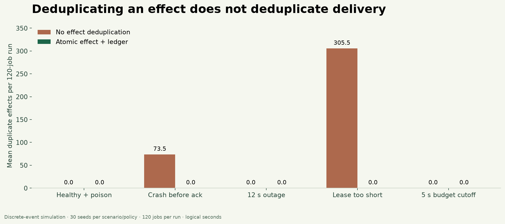
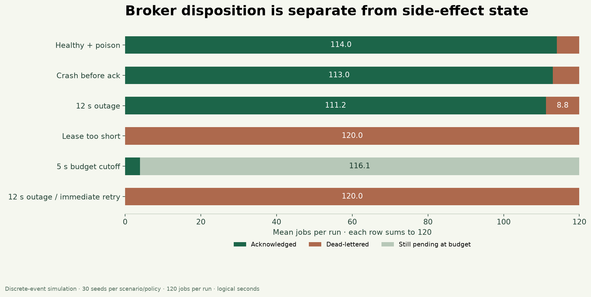

# Job reliability lab

**[View the report in your browser](https://Michaelhoang8.github.io/job-reliability-lab/)**

A reproducible distributed-systems/SRE study of job delivery, worker crashes, visibility timeouts, retry budgets and idempotent effects. **This is a discrete-event simulation, not a deployed broker or live infrastructure benchmark.** Every duration is logical time.



Across 30 seeds, the crash-before-ack scenario produces **73.5 duplicate effects per 120-job run** without deduplication, and zero with the modeled atomic ledger. Both policies have identical delivery attempts and acknowledgement schedules: deduplicating effects does not create exactly-once delivery.

The short-lease scenario exposes a different failure: all jobs reach the DLQ, but an average **114.0 already have an effect**. Blindly replaying those jobs would be unsafe without application-level reconciliation.

## Review the work

| Artifact | What to inspect |
|---|---|
| [Screenshot gallery](docs/screenshots/README.md) / [Recorded walkthrough](docs/recordings/README.md) | Actual browser captures and recorded review of the generated report |
| [Visual report](docs/report.html) | Six sections covering delivery, retries, leases, traces and operational response |
| [Run outcomes](results/runs.csv) / [summary](results/summary.csv) | 450 actual simulation runs: five scenarios × three policies × 30 seeds |
| [Replayable JSONL traces](results/traces) | Seven complete event streams, including naive crash and immediate-retry outage failures |
| [Architecture decision](docs/architecture-decision.md) | Transaction boundaries, receipt validation, atomicity assumptions and omitted production features |
| [Operational runbook](docs/runbook.md) | Diagnose duplicate effects, DLQ backlog and premature lease expiry before redrive |
| [Metric dictionary](docs/metrics.md) | Denominators, latency censoring, pending versus terminal states |
| [Model source](src/simulator.py) | Heap-based scheduler, worker/broker states, jitter and atomic ledger |
| [Scenario definitions](scripts/run_experiments.py) | All scenario parameters and policy configurations |
| [Adversarial tests](tests/test_simulator.py) | Crash ordering, stale receipts, exact timeout boundaries, in-flight budget stops and payload mismatch |

Skills demonstrated: failure modeling, queue semantics, idempotency design, deterministic simulation, trace auditing, retry policy, operational metrics and adversarial correctness testing.

## Three policies

- **Naive + backoff:** repeated deliveries can repeat an effect; retries use exponential backoff with full jitter.
- **Atomic + backoff:** the idempotency key and effect commit in one modeled transaction; same failure draws and schedule as naive + backoff.
- **Atomic + immediate retry:** same atomic-effect assumption, but no backoff delay. The worker pool and attempt budget still constrain retries.

The atomic ledger is an explicit assumption. It does not represent a dedup-table insert followed by an unrelated HTTP side effect. A reused key with a different payload raises an error in the ledger API. Generated jobs have unique, immutable keys and payloads.

## Five scenarios

| Scenario | Failure being tested |
|---|---|
| `healthy` | No transient failures or worker crashes; a seeded poison-job fraction still reaches the DLQ |
| `crash_window` | A worker can crash after applying the effect and before acknowledgement |
| `downstream_outage` | All effect attempts fail before application until logical second 12; immediate retries can exhaust six attempts before recovery |
| `short_visibility` | 0.6-second leases expire before 2–4-second processing; stale acknowledgements are rejected |
| `budget_cutoff` | Execution stops at logical second 5; pending and executing jobs remain unsettled rather than being declared lost |



The broker accepts an acknowledgement only for the current receipt generation. Lease expiry does **not** release a busy worker. That worker can still apply an effect later, even after the broker has dead-lettered the job. A run is drained only when no pending jobs and no executing tasks remain.

## Reproduce

Python 3.13 was used for the committed run. Simulation and tests require only the standard library; plotting uses the pinned dependencies.

```sh
python -m venv .venv
# Windows PowerShell: .venv\Scripts\Activate.ps1
# macOS/Linux: source .venv/bin/activate
python -m pip install -r requirements.txt
python scripts/run_experiments.py
python scripts/render_report.py
python -m unittest discover -s tests -v
```

The default experiment overwrites generated files in `results/`. Outcomes are deterministic for the same source, configuration and seeds; execution metadata records the actual run date. To preserve the published results while checking a smaller set:

```sh
python scripts/run_experiments.py --seeds 3 --output results-ci
```

Audit a saved trace without running the scheduler:

```sh
python scripts/replay_trace.py results/traces/crash_window--naive_backoff--seed0.jsonl
```

The replay auditor recomputes terminal states and effect counts from the event stream. It rejects invalid terminal transitions, decreasing logical time and mismatched summary counts. It is an accounting audit, not an independent implementation of all scheduling rules.

Open `docs/report.html` in a browser or serve the repository with `python -m http.server 8000 --bind 127.0.0.1`, then visit `http://localhost:8000/docs/report.html`. GitHub shows the HTML source directly; charts, CSVs and Markdown are reviewable without running a server.

## What the results do—and do not—establish

The simulation verifies accounting invariants and demonstrates failure modes under stated assumptions. It does not prove a live queue is reliable, establish production latency or throughput, or promise exactly-once delivery. In particular, it omits broker persistence failures, network partitions, lease renewal, clock disagreement, ledger TTL/retention, payload migration and real external effect transactions.

Latency statistics include only the relevant observed population: acknowledgement latency excludes unacknowledged jobs; first-delivery lag excludes jobs not yet delivered. Summary values are means of per-run p95 values, not pooled production p95 estimates. Compare them with acknowledgement and pending counts.

This is an AI-assisted engineering portfolio study. Code and documentation were developed with assistance; the saved outcomes and traces come from actual executions of the explicitly simulated model. No employer outcomes, deployment or achieved savings are claimed.
